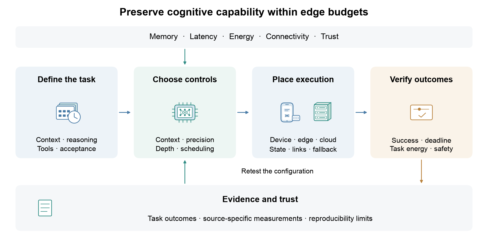
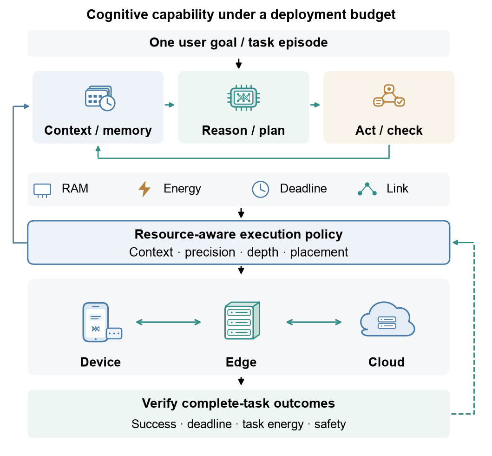
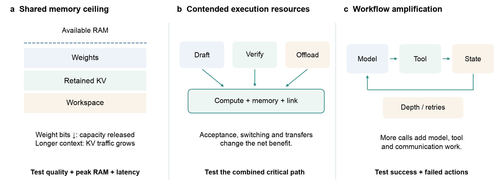
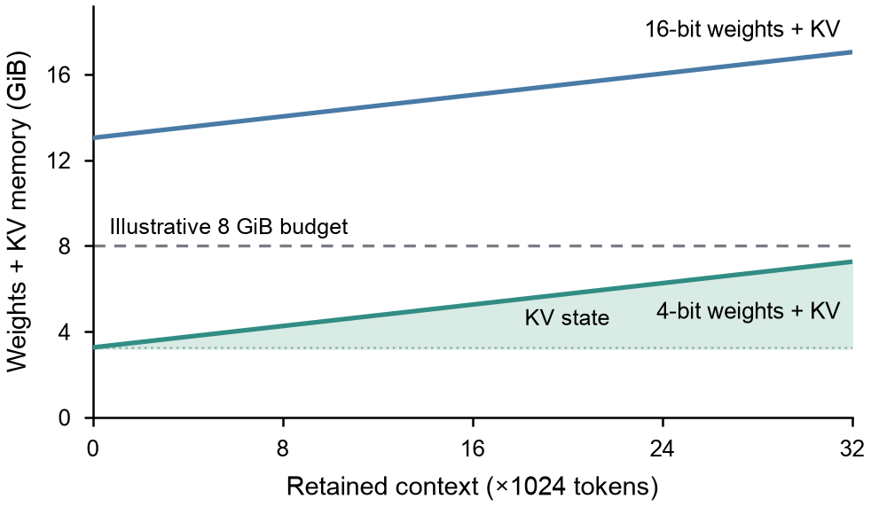
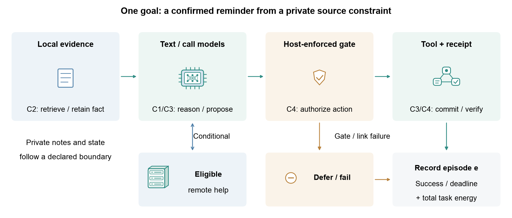
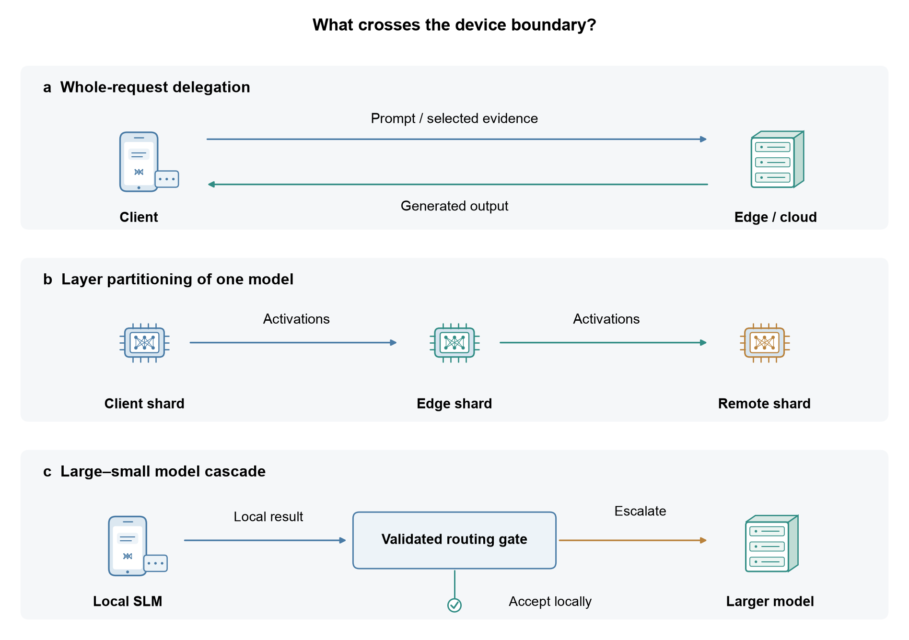
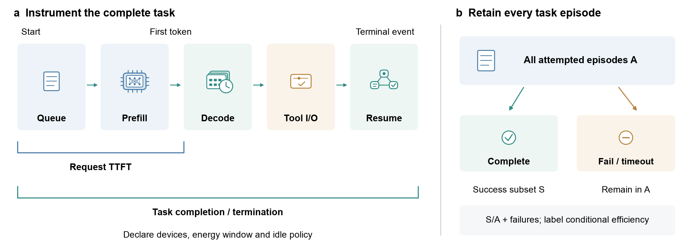

# Awesome Edge AI

[](https://awesome.re)
[](https://github.com/wangxb96/Awesome-EdgeAI/stargazers)
[](LICENSE.md)

**From data–model–system optimization to cognitive edge computing.** A curated guide to compact language and multimodal models, tool-using agents, and the model–runtime–network choices that make them useful on client devices and nearby servers.

A deployment must preserve a declared task outcome while fitting memory, latency, energy, connectivity and trust constraints. This single-page guide follows that decision: what the task requires, which bottleneck a technique changes, where it executes, and what its evidence measures.



## Contents

- [Survey versions and repositories](#survey-versions-and-repositories)
- [Deployment framework](#deployment-framework)
- [Models and runtimes](#models-and-runtimes)
- [Optimization under deployment budgets](#optimization-under-deployment-budgets)
- [Agents and applications](#agents-and-applications)
- [Evaluation and trust](#evaluation-and-trust)
- [Foundations and surveys](#foundations-and-surveys)
- [Research artifacts and figures](#research-artifacts-and-figures)
- [Citation](#citation)

## Survey versions and repositories

The current public preprint is [Cognitive Edge Computing: A Comprehensive Survey on Optimizing Large Models and AI Agents for Pervasive Deployment](https://arxiv.org/abs/2501.03265v2). The two versions share arXiv identifier **2501.03265** and document the manuscript's progression from the optimization triad to cognitive workloads and agents.

| Version | Bibliographic record | Repository and scope |
|---|---|---|
| **v1 · 4 January 2025** | **Xubin Wang and Weijia Jia.** [Optimizing Edge AI: A Comprehensive Survey on Data, Model, and System Strategies](https://arxiv.org/abs/2501.03265v1). arXiv:2501.03265v1. | [Awesome-EdgeAI](https://github.com/wangxb96/Awesome-EdgeAI): the data–model–system resource collection, now maintained here together with the cognitive-edge material. |
| **v2 · 7 November 2025** | **Xubin Wang, Qing Li and Weijia Jia.** [Cognitive Edge Computing: A Comprehensive Survey on Optimizing Large Models and AI Agents for Pervasive Deployment](https://arxiv.org/abs/2501.03265v2). arXiv:2501.03265v2. | [cognitive-edge-llm-agent-survey](https://github.com/wangxb96/cognitive-edge-llm-agent-survey): focused LLM/agent literature map; [Awesome-EdgeAI](https://github.com/wangxb96/Awesome-EdgeAI): this consolidated guide and the current protocol, census and editable figures. |

The associated journal manuscript is titled *Cognitive Edge Computing: A Survey on Optimizing Large Language Models and Autonomous Agents for the Edge*. Its current reproducibility artifacts are maintained in this repository. Version-specific BibTeX records are provided under [Citation](#citation).

## Deployment framework

1. **Define acceptance.** Specify the useful outcome, required evidence, deadline and permitted actions. A valid model response can still be an incomplete user task.
2. **Measure the bottleneck.** Separate weights, retained KV, workspace, prefill, decode, tools, communication and sustained thermal behavior.
3. **Choose compatible controls.** Context selection, precision, reasoning depth, scheduling and placement change different costs. Verify their interaction on the intended runtime.
4. **Validate the entire episode.** Include retries, failed/deferred tasks, tool effects and all declared devices in the accounting. Use task success alongside quality proxies and execution metrics.

For example, a private mobile assistant may retrieve one decisive fact locally, use a compact text model or bounded function caller, validate the proposed tool action, and defer if neither local nor permitted remote execution meets the acceptance conditions. A workstation agent, a phone demonstration and a network simulator support different deployment claims.


## Models and runtimes

Choose the model's role before its size. A text model, visual encoder, function caller and orchestration framework provide different components of an application. Released parameter counts are not total resident application memory. Pin the model, tokenizer/template, precision format, runtime and device revision for a run.



### Role-matched model artifacts

| Role | Representative artifacts | Deployment question |
|---|---|---|
| Local text, retrieval and bounded reasoning | [Qwen3 0.6B/1.7B/4B](https://huggingface.co/Qwen/Qwen3-1.7B), [Llama 3.2 1B/3B Instruct](https://huggingface.co/meta-llama/Llama-3.2-1B-Instruct), [SmolLM2 135M/360M/1.7B](https://huggingface.co/HuggingFaceTB/SmolLM2-1.7B-Instruct) | Does the selected precision and context preserve task correctness within sustained memory/latency limits? |
| Bounded device actions | [FunctionGemma 270M](https://ai.google.dev/gemma/docs/functiongemma/model_card), [Mobile Actions example](https://developers.googleblog.com/on-device-function-calling-in-google-ai-edge-gallery/) | Who parses, authorizes, confirms and executes each call? A function caller alone is not an autonomous planner. |
| Visual and audio assistance | [Gemma 3n E2B/E4B](https://ai.google.dev/gemma/docs/gemma-3n), [FastVLM](https://github.com/apple/ml-fastvlm), [MiniCPM-V](https://github.com/OpenBMB/MiniCPM-V) | Include encoder/token cost, conditional loading and modality quality; effective-size labels are not complete RAM estimates. |
| Low-bit local text | [BitNet](https://github.com/microsoft/BitNet) | Does the backend execute the intended low-bit kernels, and what quality/traffic trade-off results? |
| Personal-device agent | [TinyAgent](https://github.com/SqueezeAILab/TinyAgent) | Are planner, executor, tool state and final task verification all accounted for? |

### Model reports

- [Qwen3 Technical Report](https://arxiv.org/abs/2505.09388) (arXiv 2025) — Text-model family and reasoning-mode controls.
- [Gemma 3 Technical Report](https://arxiv.org/abs/2503.19786) (arXiv 2025) — Gemma 3 model family and its published evaluation scope.
- [MiniCPM4: Ultra-Efficient LLMs on End Devices](https://arxiv.org/abs/2506.07900) (arXiv 2025) — End-device-oriented model and inference design.
- [BitNet b1.58 2B4T Technical Report](https://arxiv.org/abs/2504.12285) (arXiv 2025) — Low-bit model and associated inference assumptions.
- [MobileLLM: Optimizing Sub-billion Parameter Language Models for On-Device Use Cases](https://arxiv.org/abs/2402.14905) (arXiv 2024) — Sub-billion model design for on-device use.
- [MobileLLM-R1: Exploring the Limits of Sub-Billion Language Model Reasoners with Open Training Recipes](https://arxiv.org/abs/2509.24945) (arXiv 2025) — Open training recipes for small reasoning models.
- [MiniCPM-V: A GPT-4V Level MLLM on Your Phone](https://arxiv.org/abs/2408.01800) (arXiv 2024) — Mobile-oriented vision-language modeling.
- [MiniCPM-o 4.5: Towards Real-Time Full-Duplex Omni-Modal Interaction](https://arxiv.org/abs/2604.27393) (arXiv 2026) — Full-duplex multimodal interaction; evaluate the complete streaming pipeline.

### Generative inference stacks

| Stack | Intended execution role | Check before comparison |
|---|---|---|
| [llama.cpp](https://github.com/ggml-org/llama.cpp) | GGUF model execution across supported CPU/GPU and other backends | Quantizer revision, actual backend and operator fallback |
| [MLC LLM](https://github.com/mlc-ai/mlc-llm) | Compiled deployment to supported mobile, browser and accelerator targets | Target build, compilation and model-library compatibility |
| [ExecuTorch](https://github.com/pytorch/executorch) | PyTorch model export and on-device execution | Delegation, supported operators and exported graph |
| [LiteRT](https://github.com/google-ai-edge/LiteRT) / [LiteRT-LM](https://github.com/google-ai-edge/LiteRT-LM) | On-device ML and generative-model execution | Supported model conversion and selected device accelerator |
| [MLX](https://github.com/ml-explore/mlx) / [MLX LM](https://github.com/ml-explore/mlx-lm) | Apple Silicon arrays, language-model generation and adaptation | Unified-memory residency and measured device/configuration |
| [ONNX Runtime](https://github.com/microsoft/onnxruntime) / [GenAI](https://github.com/microsoft/onnxruntime-genai) | ONNX execution providers and generation loop | Execution provider, graph partitions, KV layout and sampling |
| [MNN](https://github.com/alibaba/MNN) / [ncnn](https://github.com/Tencent/ncnn) | Mobile and embedded inference | Model-specific operator and precision support |
| [Transformers.js](https://github.com/huggingface/transformers.js) | Browser/JavaScript inference | Browser backend, memory limits and model format |
| [TensorRT-LLM](https://github.com/NVIDIA/TensorRT-LLM) | Supported NVIDIA accelerator serving | Exact GPU/platform support; do not infer phone portability |

Use current vendor documentation for [Core ML](https://developer.apple.com/documentation/coreml), [Qualcomm AI Hub](https://aihub.qualcomm.com/) and [LiteRT](https://developers.google.com/edge/litert/overview). Version-specific accelerator paths change. Runtime availability does not establish equal capability or performance across targets.

### MCU and embedded inference

[TensorFlow Lite Micro](https://github.com/tensorflow/tflite-micro), [CMSIS-NN](https://github.com/ARM-software/CMSIS-NN), [TinyEngine](https://github.com/mit-han-lab/tinyengine) and [emlearn](https://github.com/emlearn/emlearn) support constrained inference roles. Their small-network results should not be presented as evidence that a complete LLM agent fits an MCU. See the [foundations](#constrained-learning-foundations) for the relevant model and training regimes.

## Optimization under deployment budgets

Start from a feasible, correct baseline and a measured bottleneck. Weight storage, KV state, visual encoding, decoding, tool calls and wireless transfers compete for different resources. A gain in one phase need not improve complete-task latency or energy.



### Context, state and memory



The [analytical memory illustration](survey/figures/memory_budget.pdf) separates fixed weight storage from context-dependent KV growth. Its [CSV](survey/figures/memory_budget_analytical.csv) is formula-generated, not a device benchmark; workspace and operating-system cost are excluded.

- [Efficient Memory Management for Large Language Model Serving with PagedAttention](https://arxiv.org/abs/2309.06180) (arXiv 2023) — Paged KV management for serving; mobile transfer requires a supported implementation.
- [DUAL-BLADE: Dual-Path NVMe-Direct KV-Cache Offloading for Edge LLM Inference](https://arxiv.org/abs/2604.26557) (arXiv 2026) — Storage-backed KV transfer and edge execution.
- [MemLLM: End-to-end In-Storage Acceleration of On-device Retrieval-Augmented Generation using Precomputed KV Caches](https://arxiv.org/abs/2610.22579) (arXiv 2026) — Precomputed RAG state and storage/compute interaction.
- [Lightweight Chunk Selection for Mobile Retrieval-Augmented Generation](https://arxiv.org/abs/2608.03148) (arXiv 2026) — Selection of retrieved context before mobile generation.

### Precision and model structure

- [AWQ: Activation-aware Weight Quantization for LLM Compression and Acceleration](https://arxiv.org/abs/2306.00978) (arXiv 2023) — Activation-aware weight quantization and its executable kernel path.
- [GPTQ: Accurate Post-Training Quantization for Generative Pre-trained Transformers](https://arxiv.org/abs/2210.17323) (arXiv 2022) — Post-training weight quantization.
- [SmoothQuant: Accurate and Efficient Post-Training Quantization for Large Language Models](https://arxiv.org/abs/2211.10438) (arXiv 2022) — Joint treatment of activation/weight dynamic ranges.
- [The Era of 1-bit LLMs: All Large Language Models are in 1.58 Bits](https://arxiv.org/abs/2402.17764) (arXiv 2024) — Low-bit model representation; storage and runtime remain distinct.
- [Large Models for Small Devices: Recent Advances and Empirical Analysis of Edge AI Deployment](https://arxiv.org/abs/2608.15693) (arXiv 2026) — Checks whether compression changes survive artifact export and actual execution.
- [Does Mixture-of-Experts Actually Help Inference on Consumer and Edge Hardware? An Empirical Study](https://arxiv.org/abs/2606.21428) (arXiv 2026) — Separates active expert arithmetic from total storage and memory traffic.

- [MobileQuant: Mobile-friendly Quantization for On-device Language Models](https://doi.org/10.18653/v1/2024.findings-emnlp.570) (EMNLP Findings 2024) — quantization and operator conditions for mobile inference.
- [Token-Importance Guided Direct Preference Optimization](https://proceedings.iclr.cc/paper_files/paper/2026/hash/172fe9f8cc55953bad5c24774bf0142b-Abstract-Conference.html) (ICLR 2026) — behavioral alignment; its quality objective is separate from a hardware precision reduction.

### Decoding and test-time work

- [Accelerating Large Language Model Decoding with Speculative Sampling](https://arxiv.org/abs/2302.01318) (arXiv 2023) — Draft/verify decoding and its sampling assumptions.
- [QSpec: Speculative Decoding with Complementary Quantization Schemes](https://arxiv.org/abs/2410.11305) (arXiv 2024) — Complementary precision paths for speculation.
- [FastTTS: Accelerating Test-Time Scaling for Edge LLM Reasoning](https://arxiv.org/abs/2509.00195) (arXiv 2025) — Verifier-guided reasoning search (ASPLOS 2026); beam goodput differs from completed user goals.
- [SpecQuant: Speculative Decoding with Multi-Parent Quantization for Adaptive LLM Inference](https://arxiv.org/abs/2609.21704) (arXiv 2026) — Adaptive precision variants and speculative inference.

- [EAGLE-2: Faster Inference of Language Models with Dynamic Draft Trees](https://doi.org/10.18653/v1/2024.emnlp-main.422) (EMNLP 2024).

Measure drafting, verification, switching, accepted output and rejected work together. Acceptance rate alone cannot establish speedup, and a reasoning-token cap alone cannot establish preserved task quality.

### Runtime, scheduling and hardware mapping

- [PowerInfer: Fast Large Language Model Serving with a Consumer-grade GPU](https://arxiv.org/abs/2312.12456) (arXiv 2023) — Consumer-GPU sparse-activation serving.
- [PowerInfer-2: Fast Large Language Model Inference on a Smartphone](https://arxiv.org/abs/2406.06282) (arXiv 2024) — Smartphone inference and heterogeneous memory/execution design.
- [SLICE: SLO-Driven Scheduling for LLM Inference on Edge Computing Devices](https://arxiv.org/abs/2510.18544) (arXiv 2025) — SLO-driven edge scheduling.
- [EPARA: Parallelizing Categorized AI Inference in Edge Clouds](https://arxiv.org/abs/2511.00603) (arXiv 2025) — Parallel execution in edge clouds.
- [FourierCompress: Layer-Aware Spectral Activation Compression for Efficient and Accurate Collaborative LLM Inference](https://arxiv.org/abs/2510.16418) (arXiv 2025) — Activation transfer in collaborative inference.
- [EdgeXpert: An Edge Device for Memory-Efficient LLM Inference with Mixture-of-Experts and Speculative Decoding](https://arxiv.org/abs/2608.05303) (arXiv 2026) — MoE/speculation hardware–software co-design; retain the reported accelerator boundary.
- [EnerInfer: Energy-Aware On-Device LLM Inference](https://arxiv.org/abs/2606.23001) (arXiv 2026) — Energy-aware device execution with frequency and thermal constraints.

- [Fast On-Device LLM Inference with NPUs](https://doi.org/10.1145/3669940.3707239) (ASPLOS 2025).
- [T-MAC: CPU Renaissance via Table Lookup for Low-bit LLM Deployment on Edge](https://doi.org/10.1145/3689031.3696099) (EuroSys 2025).
- [SwapMoE: Serving Off-the-shelf MoE-based Large Language Models with Tunable Memory Budget](https://doi.org/10.18653/v1/2024.acl-long.363) (ACL 2024).

### Adaptation and federated learning

- [LoRA: Low-Rank Adaptation of Large Language Models](https://arxiv.org/abs/2106.09685) (arXiv 2021) — Low-rank adaptation with a retained base model.
- [DoRA: Weight-Decomposed Low-Rank Adaptation](https://arxiv.org/abs/2402.09353) (arXiv 2024) — Weight-decomposed adaptation.
- [Memory-Efficient Structured Backpropagation for On-Device LLM Fine-Tuning](https://arxiv.org/abs/2602.13069) (arXiv 2026) — Structured backpropagation for memory-constrained fine-tuning.
- [TrainDeeploy: Hardware-Accelerated Parameter-Efficient Fine-Tuning of Small Transformer Models at the Extreme Edge](https://arxiv.org/abs/2603.09511) (arXiv 2026) — Hardware-aware adaptation of small transformers at the extreme edge.
- [Training Specialist LLMs on Your Phone: Forward-Only Optimization via Block-Spectral Coordinates](https://arxiv.org/abs/2611.04797) (arXiv 2026) — Forward-only phone specialization; retain its demonstrated training conditions.
- [Unlocking the Edge deployment and ondevice acceleration of multi-LoRA enabled one-for-all foundational LLM](https://arxiv.org/abs/2604.18655) (arXiv 2026) — Multi-adapter execution and mobile acceleration.
- [Federated Learning of Large Language Models with Parameter-Efficient Prompt Tuning and Adaptive Optimization](https://arxiv.org/abs/2310.15080) (arXiv 2023) — Parameter-efficient federated adaptation and optimization.
- [Parameter-Efficient and Personalized Federated Training of Generative Models at the Edge](https://arxiv.org/abs/2511.11585) (arXiv 2025) — Personalized generative adaptation across edge clients.
- [FED-FSTQ: Fisher-Guided Token Quantization for Communication-Efficient Federated Fine-Tuning of LLMs on Edge Devices](https://arxiv.org/abs/2604.25421) (arXiv 2026) — Communication-aware federated token quantization.
- [Thermo-FL: Thermal-Aware Robust Federated Fine-Tuning of Large Language Models for Edge AI](https://arxiv.org/abs/2608.21172) (arXiv 2026) — Thermal-aware federated fine-tuning.

- [QLoRA: Efficient Finetuning of Quantized LLMs](https://proceedings.neurips.cc/paper_files/paper/2023/hash/1feb87871436031bdc0f2beaa62a049b-Abstract.html) (NeurIPS 2023).
- [Federated Black-box Prompt Tuning System for Large Language Models on the Edge](https://doi.org/10.1145/3636534.3698856) (MobiCom 2024).

Tooling: [AWQ](https://github.com/mit-han-lab/llm-awq), [GPTQ](https://github.com/IST-DASLab/gptq), [SmoothQuant](https://github.com/mit-han-lab/smoothquant), [OmniQuant](https://github.com/OpenGVLab/OmniQuant), [PEFT](https://github.com/huggingface/peft), [bitsandbytes](https://github.com/bitsandbytes-foundation/bitsandbytes).

Report whether adapters are merged, switched or served concurrently. Base weights, activation memory, communication, update cost and quality drift remain relevant after trainable parameters are reduced.

## Agents and applications

An agent combines a model with task state, tools and a stopping policy. The deployment unit is the user goal, including repeated calls and recovery. The same workflow may execute locally, at a gateway or through permitted cloud delegation.



### Planning, execution and state

- [ReAct: Synergizing Reasoning and Acting in Language Models](https://arxiv.org/abs/2210.03629) (arXiv 2022) — Reasoning/action interleaving; edge cost must include the full trajectory.
- [MemGPT: Towards LLMs as Operating Systems](https://arxiv.org/abs/2310.08560) (arXiv 2023) — Tiered agent memory and context management.
- [Small Language Models are the Future of Agentic AI](https://arxiv.org/abs/2506.02153) (arXiv 2025) — Small-model roles within agent systems.
- [Nexus: An Execution Fabric for AI Agents Across Cloud, Edge, and Devices](https://arxiv.org/abs/2610.05709) (arXiv 2026) — Persistent cross-device tasks, delegation and permission state.

- [Agent-X: Full Pipeline Acceleration of On-device AI Agents](https://doi.org/10.1145/3745756.3809195) (MobiSys 2026) — prompt/cache and drafting co-design; the published personal-computer platform is not a phone energy measurement.

### Reasoning budgets and predictive planning

- [Resource-Aware Agentic AI Reasoning for Mobile Edge General Intelligence](https://doi.org/10.1109/MWC.2026.3740386) (IEEE Wireless Communications 2026) — reasoning work as a deployment control, with controller overhead and task quality to be evaluated jointly.
- [Edge General Intelligence Through World Models, Large Language Models, and Agentic AI: Fundamentals, Solutions, and Challenges](https://doi.org/10.1109/TCCN.2026.3658762) (IEEE TCCN 2026) — predictive state and planning introduce additional memory, update and simulation costs.

### Retrieval-augmented workflows

- [Energy-Efficient On-Device RAG on a Mobile NPU: System Design and Benchmark on Snapdragon X Elite](https://arxiv.org/abs/2606.11257) (arXiv 2026) — Embedding, retrieval, reranking and generation on a specified mobile-NPU platform.
- [A Memory-Efficient Retrieval Architecture for RAG-Enabled Wearable Medical LLMs-Agents](https://arxiv.org/abs/2510.27107) (arXiv 2025) — Memory-constrained retrieval for wearable medical assistance.

Context-selection and cached-state mechanisms are in [Optimization](#context-state-and-memory). Include retrieval index freshness, resident state and evidence recall in the task acceptance check.

### Delegation and distributed execution



Full-request delegation transfers selected evidence; model partitioning transfers intermediate state; a large–small cascade routes between models. Compare like tasks and record payload, state ownership, link conditions, retries and fallback.

- [EdgeWise: Bringing Long-Horizon Agents to the Edge via Selective Cloud Delegation](https://arxiv.org/abs/2610.17560) (arXiv 2026) — Step-level cloud delegation in long-horizon tasks; its DGX Spark demonstration does not establish phone feasibility.
- [DiSCo: Device-Server Collaborative LLM-Based Text Streaming Services](https://arxiv.org/abs/2502.11417) (arXiv 2025) — Device–server text streaming.
- [CLONE: Customizing LLMs for Efficient Latency-Aware Inference at the Edge](https://arxiv.org/abs/2506.02847) (arXiv 2025) — Latency-aware model customization.
- [GELATO: Generative Entropy- and Lyapunov-based Adaptive Token Offloading for Device-Edge Speculative LLM Inference](https://arxiv.org/abs/2605.10124) (arXiv 2026) — Token offloading and device–edge speculative execution.
- [When Cloud Agents Meet Device Agents: Lessons from Hybrid Multi-Agent Systems](https://arxiv.org/abs/2605.30102) (arXiv 2026) — Hybrid cloud/device multi-agent design choices.

- [EdgeShard: Efficient LLM Inference via Collaborative Edge Computing](https://doi.org/10.1109/JIOT.2024.3524255) — heterogeneous placement and communication.
- [Quality-of-Service Aware LLM Routing for Edge Computing with Multiple Experts](https://doi.org/10.1109/TMC.2025.3590969) — task-dependent routing under service constraints.

### LLMs controlling edge networks

Running a model on an edge device and using an LLM to control a network are complementary roles. Assess controller utility, inference overhead, action feasibility and decision deadlines separately.

- [Cooperative Edge Caching With Large Language Model in Wireless Networks](https://doi.org/10.1109/TMC.2026.3687739) (TMC 2026) — constrained text-to-action network control; content caching differs from KV-cache management.
- [Large Language Model-Enhanced Deep Reinforcement Learning for Secure Data Collection in Low-Altitude Economy Networking](https://doi.org/10.1109/TMC.2026.3665241) (TMC 2026) — LLM-assisted state/reward/feedback design.
- [Intelligent Mobile AI-Generated Content Services via Interactive Prompt Engineering and Dynamic Service Provisioning](https://doi.org/10.1109/TMC.2026.3668214) (TMC 2026) — prompt refinement coupled to inference trials and communication allocation.

- [CORE:Toward Ubiquitous 6G Intelligence Through Collaborative Orchestration of Large Language Model Agents Over Hierarchical Edge](https://arxiv.org/abs/2601.21822) (arXiv 2026) — Hierarchical coordination of edge agents.
- [6G Needs Agents: Toward Agentic AI-Native Networks for Autonomous Intelligence](https://arxiv.org/abs/2605.01546) (arXiv 2026) — Agentic network architectures and their open design questions.
- [A Task Decomposition and Planning Framework for Efficient LLM Inference in AI-Enabled WiFi-Offload Networks](https://arxiv.org/abs/2604.21399) (arXiv 2026) — Task decomposition in WiFi/offload networks.
- [From Semantic to Token Communication: The Next Paradigm for Large-Model-Driven 6G Intelligent Connectivity](https://arxiv.org/abs/2609.10714) (arXiv 2026) — Token-level communication as a proposed semantic interface.

### Application-specific boundaries

- [Lessons Learned from Developing a Privacy-Preserving Multimodal Wearable for Local Voice-and-Vision Inference](https://arxiv.org/abs/2511.11811) (arXiv 2025) — Local voice/vision wearable design and deployment lessons.
- [VoiceAlign: A Shimming Layer for Enhancing the Usability of Legacy Voice User Interface Systems](https://arxiv.org/abs/2602.22374) (arXiv 2026) — Voice-interface usability and compatibility.
- [BitRL-Light: 1-bit LLM Agents with Deep Reinforcement Learning for Energy-Efficient Smart Home Lighting Optimization](https://arxiv.org/abs/2512.20623) (arXiv 2025) — Language-model and RL components for smart lighting.
- [An Agentic AI Framework with Large Language Models and Chain-of-Thought for UAV-Assisted Logistics Scheduling with Mobile Edge Computing](https://arxiv.org/abs/2605.13221) (arXiv 2026) — UAV logistics planning with mobile-edge resources.
- [Rethinking On-Device LLM Reasoning: Why Analogical Mapping Outperforms Abstract Thinking for IoT DDoS Detection](https://arxiv.org/abs/2601.14343) (arXiv 2026) — Task-specific reasoning for IoT attack detection.
- [AdaDINO: Context-Adaptive DINO-Distilled Vision Foundation Models for Efficient Open-Vocabulary Edge Inference](https://arxiv.org/abs/2604.15622) (arXiv 2026) — Context-adaptive visual inference.
- [Octo: An Open-Source Generalist Robot Policy](https://arxiv.org/abs/2405.12213) (arXiv 2024) — Generalist robot policy; validate action timing and physical safety for each target.
- [π_0: A Vision-Language-Action Flow Model for General Robot Control](https://arxiv.org/abs/2410.24164) (arXiv 2024) — Vision-language-action modeling and continuous control.

A healthcare-oriented model or a smart-home prototype is not, by itself, a validated clinical or production deployment. State the environment, permitted actions, human confirmation and failure handling. The [evaluation guide](#evaluation-and-trust) distinguishes these outcomes from token-level quality and runtime speed.

## Evaluation and trust

Measure the capability being claimed at the deployment boundary where it matters. Direct task success, language-model quality proxies and execution measurements answer different questions. Publication venue and code availability are separate from whether a result can be reconstructed.



### Complete-task outcomes

For A attempted episodes and S successes, report S/A with failed and timed-out attempts included. Mean attempt energy is total attempted-task energy divided by A; amortized energy per success uses the same numerator divided by S and is undefined for S=0. A success-only conditional mean answers a different question. Keep request TTFT and p95 separate from task completion time and deadline satisfaction.

- [Empowering Edge Agents: A Systematic Analysis of Edge-Cloud Collaboration in LLM Agent Execution](https://arxiv.org/abs/2610.17816) (arXiv 2026) — EC²-Bench evaluates executable long-horizon tasks, cloud usage and privacy exposure. Estimated local FLOPs are not measured device energy.

The [benchmark protocol](survey/benchmark_protocol.md) specifies future logs, grouping and energy boundaries. The [helper](survey/compute_ci.py) summarizes supplied request records and does not reconstruct missing historical traces or infer episode success from call success.

### Device and sustained-session studies

- [MobileAIBench: Benchmarking LLMs and LMMs for On-Device Use Cases](https://arxiv.org/abs/2406.10290) (arXiv 2024) — On-device language/multimodal capability benchmarks.
- [Understanding Large Language Models in Your Pockets: Performance Study on COTS Mobile Devices](https://arxiv.org/abs/2410.03613) (arXiv 2024) — Measurements on commodity mobile devices.
- [LLM Inference at the Edge: Mobile, NPU, and GPU Performance Efficiency Trade-offs Under Sustained Load](https://arxiv.org/abs/2603.23640) (arXiv 2026) — Backend behavior under sustained load.
- [An Evaluation of LLMs Inference on Popular Single-board Computers](https://arxiv.org/abs/2511.07425) (arXiv 2025) — Quantized inference on single-board computers.
- [Characterizing and Understanding Energy Footprint and Efficiency of Small Language Model on Edges](https://arxiv.org/abs/2511.11624) (arXiv 2025) — Platform-specific energy and efficiency measurements.
- [Edge Deployment of Small Language Models, a comprehensive comparison of CPU, GPU and NPU backends](https://arxiv.org/abs/2511.22334) (arXiv 2025) — CPU/GPU/NPU execution under reported configurations.
- [Cloud to Edge: Benchmarking LLM Inference On Hardware-Accelerated Single-Board Computers](https://arxiv.org/abs/2604.24785) (arXiv 2026) — Hardware-accelerated single-board-computer measurements.
- [Phase Matters: Characterizing Heterogeneous Vision-Language Inference on a Mobile SoC](https://arxiv.org/abs/2606.27906) (arXiv 2026) — Phase-specific multimodal execution on a mobile SoC.
- [How Far Are We From On-Device VLM Inference? A Measurement Study on Edge NPUs](https://arxiv.org/abs/2610.40039) (arXiv 2026) — VLM execution and edge-NPU workload differences.
- [How Fast Can I Run My VLA? Demystifying VLA Inference Performance with VLA-Perf](https://arxiv.org/abs/2602.18397) (arXiv 2026) — VLA inference performance across execution stages.
- [VLA-HWBench: Where the Time Goes When VLA Models Run on Edge Hardware](https://arxiv.org/abs/2610.34717) (arXiv 2026) — VLA hardware pipeline breakdowns.

Benchmarks: [MLPerf Inference](https://github.com/mlcommons/inference), [MLPerf Tiny](https://github.com/mlcommons/tiny). Record the suite version, task, data split, precision, runtime, memory, thermal state, power scope and independent repetition unit. A global model leaderboard cannot replace a matched deployment study.

### Security and privacy

Locality can reduce data transfer but does not establish a complete security guarantee. State the adversary and protected objects, including model weights, retained context, sensor input, tool credentials and action state. Distinguish leakage prevention from permission enforcement and recovery.

- [Speed Kills: Exploring Confused Deputy Attacks Through Edge AI Accelerators](https://arxiv.org/abs/2605.17707) (arXiv 2026) — Accelerator interfaces and confused-deputy attack surfaces.
- [Understanding the Security Boundary of Obfuscation-based On-Device LLM Protection](https://arxiv.org/abs/2609.10117) (arXiv 2026) — Security limits of obfuscation-based on-device protection.
- [BiShield-TEE: On the (In-)Security of Unilateral Weight Obfuscation in On-Device TEE-Shielded LLM Partition](https://arxiv.org/abs/2610.21565) (arXiv 2026) — TEE-shielded partition protection and its assumptions.
- [SecureInfer: Heterogeneous TEE-GPU Architecture for Privacy-Critical Tensors for Large Language Model Deployment](https://arxiv.org/abs/2510.19979) (arXiv 2025) — Heterogeneous TEE/GPU deployment boundaries.
- [When FinTech Meets Privacy: Securing Financial LLMs with Differential Private Fine-Tuning](https://arxiv.org/abs/2509.08995) (arXiv 2025) — Differentially private financial-model adaptation.

Check confidentiality, permission scope, revocation, idempotence, network failure and stale state in the full workflow. Report security overhead on the same workload used for capability and cost measurements. See [Foundations and surveys](#foundations-and-surveys) for complementary threat surveys.

## Foundations and surveys

These sources provide starting points for mechanisms and neighboring research scopes. Foundational perception, server serving and MCU learning results transfer to cognitive edge workflows only under explicit model, runtime and task conditions.

### Edge foundations

- [Edge Computing: Vision and Challenges](https://doi.org/10.1109/JIOT.2016.2579198) (IEEE IoTJ 2016).
- [Edge Intelligence: Paving the Last Mile of Artificial Intelligence With Edge Computing](https://doi.org/10.1109/JPROC.2019.2918951) (Proceedings of the IEEE 2019).
- [Attention Is All You Need](https://proceedings.neurips.cc/paper/2017/hash/3f5ee243547dee91fbd053c1c4a845aa-Abstract.html) (NeurIPS 2017).
- [Communication-Efficient Learning of Deep Networks from Decentralized Data](https://proceedings.mlr.press/v54/mcmahan17a.html) (AISTATS 2017).
- [Deep Learning with Differential Privacy](https://arxiv.org/abs/1607.00133) (CCS 2016).

### Constrained learning foundations

- [MCUNet: Tiny Deep Learning on IoT Devices](https://proceedings.nips.cc/paper_files/paper/2020/hash/86c51678350f656dcc7f490a43946ee5-Abstract.html) (NeurIPS 2020) — model/runtime co-design for tiny deep learning.
- [TinyTL: Reduce Memory, Not Parameters for Efficient On-Device Learning](https://proceedings.neurips.cc/paper/2020/hash/81f7acabd411274fcf65ce2070ed568a-Abstract.html) (NeurIPS 2020) — memory-focused on-device learning.

- [On-Device Training Under 256KB Memory](https://arxiv.org/abs/2206.15472) (arXiv 2022) — Training under a specified small MCU memory budget.
- [Tiny Machine Learning: Progress and Futures](https://arxiv.org/abs/2403.19076) (arXiv 2024) — A synthesis of TinyML progress and open problems.
- [What changes after deployment? A survey on On-device Learning in TinyML](https://arxiv.org/abs/2605.31226) (arXiv 2026) — On-device learning changes after deployment.

These systems establish important constrained-learning mechanisms; they do not establish full LLM-agent execution on microcontrollers.

### Edge language models and collaborative intelligence

- [On-Device Language Models: A Comprehensive Review](https://arxiv.org/abs/2409.00088) (arXiv 2024) — On-device language-model landscape.
- [Small Language Models: Survey, Measurements, and Insights](https://arxiv.org/abs/2409.15790) (arXiv 2024) — Small-model measurements and design choices.
- [A Review on Edge Large Language Models: Design, Execution, and Applications](https://arxiv.org/abs/2410.11845) (arXiv 2024) — Edge-LLM design, execution and application review.
- [A Survey on Cloud-Edge-Terminal Collaborative Intelligence in AIoT Networks](https://arxiv.org/abs/2508.18803) (arXiv 2025) — Cloud–edge–terminal collaborative intelligence.
- [Beyond Self-Talk: A Communication-Centric Survey of LLM-Based Multi-Agent Systems](https://arxiv.org/abs/2502.14321) (arXiv 2025) — Communication and topology in multi-agent systems.

### Cognitive network control and agentification

- [Decision-Making Large Language Model for Wireless Communication: A Comprehensive Survey on Key Techniques](https://doi.org/10.1109/COMST.2025.3614494) (IEEE COMST 28, 3055–3088, 2026).
- [Beyond the Edge: An Advanced Exploration of Reinforcement Learning for Mobile Edge Computing, Its Applications, and Future Research Trajectories](https://doi.org/10.1109/COMST.2024.3405075) (IEEE COMST 27(1), 546–594, 2025).
- [Tutorial on Large Language Model-Enhanced Reinforcement Learning for Wireless Networks](https://doi.org/10.1109/COMST.2026.3712862) (IEEE COMST 28, 6665–6693, 2026).
- [Toward Edge General Intelligence With Agentic AI and Agentification: Concepts, Technologies, and Future Directions](https://doi.org/10.1109/COMST.2026.3651702) (IEEE COMST 28, 4285–4318, 2026).

- [LLM-Powered Agentic AI for 5G/6G Networks: A Tutorial and Survey on Architectures, Protocols, and Standardization](https://arxiv.org/abs/2607.16066) (arXiv 2026) — Agentic networking architectures, evaluation and standardization.
- [Diffusion Language Models for Mobile Edge Agentic AI: Foundations, Applications, and Challenges](https://arxiv.org/abs/2609.04778) (arXiv 2026) — Diffusion language-model pathways for edge agents.
- [Protecting On-Device AI Inference: A Systematic Review of Attacks and Defence Mechanisms](https://arxiv.org/abs/2605.29450) (arXiv 2026) — On-device inference attacks and defenses.
- [Secure Multi-LLM Agentic AI and Agentification for Edge General Intelligence by Zero-Trust: A Survey](https://arxiv.org/abs/2508.19870) (arXiv 2025) — Zero-trust multi-model agents and agentification.

The [optimization](#optimization-under-deployment-budgets), [agent](#agents-and-applications) and [evaluation](#evaluation-and-trust) guides place primary studies beside the specific mechanism or boundary they address.

## Research artifacts and figures

The repository follows the reading guide above. For files, use this directory map; the server archive and synthetic examples have separate entry points.

```text
README.md                 Integrated literature and deployment guide
survey/
  supplement/             Supplement PDF, LaTeX and build helper
  server/                 Recovered requests, provenance and offline reanalysis
  figures/                Editable sources, inputs and publication exports
  examples/               Synthetic request-format examples
  references.bib          Bibliographic source records
  cited_reference_index.json  Exact main/supplement citation inventory
  evidence_ledger.json     Result-specific evidence and artifact boundaries
  *_protocol.md, protocol.md  Scope and measurement contracts
```

Read the [supplementary material](survey/supplement/[submission identifier removed]-supp.pdf) for source locators, extended deployment checks and the worked assistant contract. The [recovered server archive](survey/server/README.md) retains the empirical record separately from synthetic helper examples. Its [LaTeX source and build instructions](survey/supplement/README.md), [bibliographic database](survey/references.bib), figure inputs and runnable format examples are included here. The complete public artifact edition is pinned to [tag `supplement-2026-11-13-v4`](https://github.com/wangxb96/Awesome-EdgeAI/tree/supplement-2026-11-13-v4).

| Artifact | Purpose |
|---|---|
| [Supplement PDF and source](survey/supplement/README.md) | Section directory, readable extended evidence, source locators and deployment contracts |
| [Study evidence ledger](survey/evidence_ledger.json) | Seventeen result-specific publication/artifact snapshots, evaluation paths and transfer limits |
| [Bibliographic database](survey/references.bib) | The survey's reference records; broader than the printed reference list |
| [Public-file inventory](survey/public_artifacts.json) / [closure check](survey/check_public_artifacts.py) | All distributed files, supplement dependencies and optional anonymous access checks |
| [Historical server record](survey/server/README.md) | Recovered requests, task definitions, all-campaign ledger, descriptive reanalysis and measurement-boundary figures |
| [Synthetic request example](survey/examples/README.md) | Runnable CSV and expected JSON for checking the helper's format and denominators; no measured performance |
| [Survey protocol](survey/protocol.md) | Scope, source verification, E1/E2/E3 publication/artifact qualification and search-record limitations |
| [Cited-reference index](survey/cited_reference_index.json) | Exact main/supplement reference entries and numbering, distinct from the broader bibliography and frozen census |
| [Benchmark protocol](survey/benchmark_protocol.md) | Request/episode boundaries, failure accounting and energy attribution |
| [Descriptive analysis helper](survey/compute_ci.py) | Summaries of supplied request records; does not infer complete-task success |
| [Literature audit](survey/verify_corpus.py) / [repository audit](survey/verify_repos.py) | Check the linked resources in this README |
| [Editable figure catalogue](survey/figures/README.md) | Sources, vector exports, analytical data and rebuild commands |

The manuscript's retained-link census is pinned to [commit `82b6110`](https://github.com/wangxb96/Awesome-EdgeAI/tree/82b6110), with 145 arXiv identifiers, 137 title-audited labels and 123 distinct recorded repository URL-root strings (122 after case folding). These are link units, not a study-screening flow; normalization does not resolve redirects or aliases. This living README and its `current_*` manifests are separate from that frozen snapshot. The [protocol](survey/protocol.md#reproduce-the-frozen-census) explains how to reproduce it.

For this README:

```sh
python3 survey/check_docs.py
python3 survey/check_public_artifacts.py
python3 survey/verify_corpus.py --offline
python3 survey/verify_repos.py
```

The literature command reuses cached primary metadata and reports missing records; the repository command checks live reachability. Version-specific records above were checked against their primary arXiv pages. A successful link check does not establish official ownership, experimental replication or suitability for a particular device.

To build the supplement, run `python3 survey/supplement/build.py` with pdfLaTeX installed. To check the analysis format without collecting measurements:

```sh
python3 survey/compute_ci.py \
  --input survey/examples/request_records_synthetic.csv \
  --out request_summary_local.json
```

The output matches [the supplied synthetic summary](survey/examples/request_summary_synthetic.json). The fixture contains invented request statuses and timings only; it cannot validate a model, estimate device performance or restore the historical records. For anonymous access to every distributed file at the pinned edition, run `python3 survey/check_public_artifacts.py --online`.

### Figure sources

| Reading purpose | Editable source | Vector export |
|---|---|---|
| Resource map | [Python](survey/figures/resource_map.py) | [PDF](survey/figures/resource_map.pdf), [SVG](survey/figures/resource_map.svg) |
| Cognitive task/resource loops | [Python](survey/figures/cognitive_edge_overview.py) | [PDF](survey/figures/cognitive_edge_overview.pdf), [SVG](survey/figures/cognitive_edge_overview.svg) |
| Analytical weight/KV budget | [Python](survey/figures/memory_budget.py), [CSV](survey/figures/memory_budget_analytical.csv) | [PDF](survey/figures/memory_budget.pdf), [SVG](survey/figures/memory_budget.svg) |
| Reported quantization / task-score trade-offs | [Python](survey/figures/quantization_fidelity.py), [source CSV](survey/figures/quantization_fidelity_source.csv) | [PDF](survey/figures/quantization_fidelity.pdf), [SVG](survey/figures/quantization_fidelity.svg) |
| Placement, collaboration, shared resources and workflow accounting | [Python](survey/figures/deployment_reasoning.py) | [Placement](survey/figures/placement_decision.pdf), [Collaboration](survey/figures/collaboration_patterns.pdf), [Couplings](survey/figures/cross_layer_couplings.pdf), [Workflow](survey/figures/workflow_evaluation.pdf) |
| Historical server results and interpretation | [Python](survey/figures/server_reanalysis.py), [record analysis](survey/server/analyze_archived.py), [CSV](survey/server/reanalysis_by_run.csv) | [Results PDF](survey/figures/server_results_reanalysis.pdf), [boundary-check PDF](survey/figures/server_measurement_boundaries.pdf) |
| Permissioned assistant | [Python](survey/figures/assistant_workflow.py) | [PDF](survey/figures/assistant_workflow.pdf), [SVG](survey/figures/assistant_workflow.svg) |

The memory illustration is formula-generated under stated assumptions. The quantization panel replots nine published QSpec scores, with no new trials or uncertainty estimates. The two server-record figures use recovered requests and an explicitly conceptual endpoint-power diagram. Remaining figures are conceptual: geometry encodes no measured performance, and pictograms denote roles. The prospective assistant is a synthesis example. Sources share a restrained palette and export editable PDF/SVG plus PNG and 600-dpi TIFF.

## Citation

Use the version corresponding to the material being cited.

### Initial data–model–system version

```bibtex
@article{wang2025optimizing_v1,
  title={Optimizing Edge AI: A Comprehensive Survey on Data, Model, and System Strategies},
  author={Wang, Xubin and Jia, Weijia},
  journal={arXiv preprint arXiv:2501.03265v1},
  year={2025},
  note={Version 1, January 4, 2025},
  url={https://arxiv.org/abs/2501.03265v1}
}
```

### Cognitive edge computing version

```bibtex
@article{wang2025cognitive_v2,
  title={Cognitive Edge Computing: A Comprehensive Survey on Optimizing Large Models and AI Agents for Pervasive Deployment},
  author={Wang, Xubin and Li, Qing and Jia, Weijia},
  journal={arXiv preprint arXiv:2501.03265v2},
  year={2025},
  note={Version 2, November 7, 2025},
  url={https://arxiv.org/abs/2501.03265v2}
}
```

Maintained by [Xubin Wang](https://github.com/wangxb96), Qing Li and Weijia Jia.

[Contribution guide](CONTRIBUTING.md) · [License](LICENSE.md)
