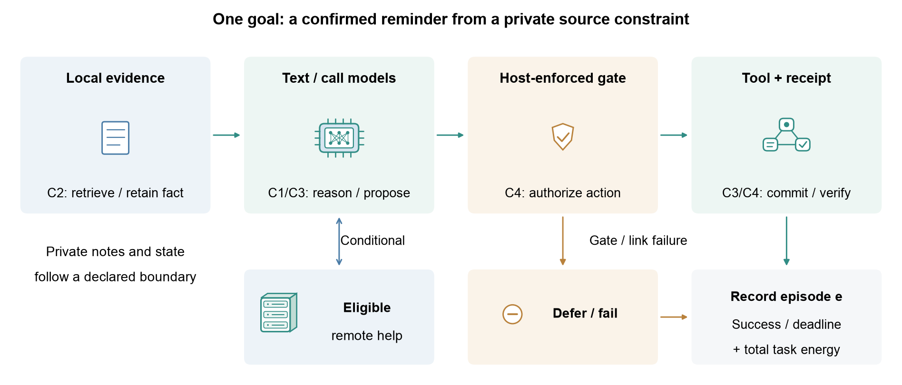
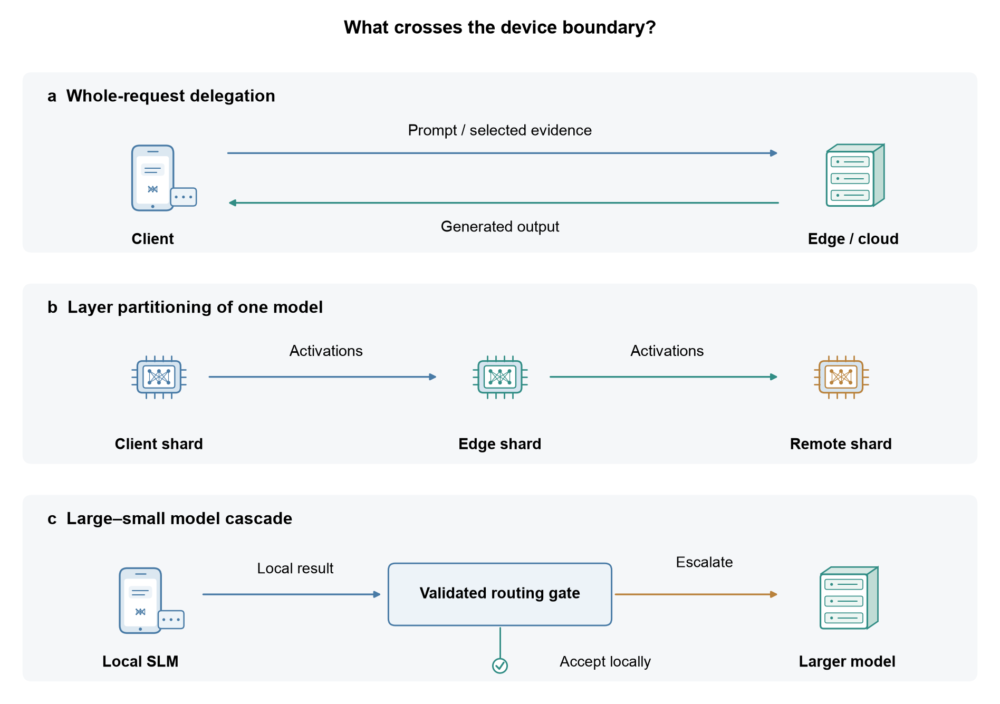

# Agents and applications

An agent combines a model with task state, tools and a stopping policy. The deployment unit is the user goal, including repeated calls and recovery. The same workflow may execute locally, at a gateway or through permitted cloud delegation.

## Planning, execution and state

- [ReAct: Synergizing Reasoning and Acting in Language Models](https://arxiv.org/abs/2210.03629) (arXiv 2022) — Reasoning/action interleaving; edge cost must include the full trajectory.
- [MemGPT: Towards LLMs as Operating Systems](https://arxiv.org/abs/2310.08560) (arXiv 2023) — Tiered agent memory and context management.
- [Small Language Models are the Future of Agentic AI](https://arxiv.org/abs/2506.02153) (arXiv 2025) — Small-model roles within agent systems.
- [Nexus: An Execution Fabric for AI Agents Across Cloud, Edge, and Devices](https://arxiv.org/abs/2610.05709) (arXiv 2026) — Persistent cross-device tasks, delegation and permission state.

- [Agent-X: Full Pipeline Acceleration of On-device AI Agents](https://doi.org/10.1145/3745756.3809195) (MobiSys 2026) — prompt/cache and drafting co-design; the published personal-computer platform is not a phone energy measurement.

## Reasoning budgets and predictive planning

- [Resource-Aware Agentic AI Reasoning for Mobile Edge General Intelligence](https://doi.org/10.1109/MWC.2026.3740386) (IEEE Wireless Communications 2026) — reasoning work as a deployment control, with controller overhead and task quality to be evaluated jointly.
- [Edge General Intelligence Through World Models, Large Language Models, and Agentic AI: Fundamentals, Solutions, and Challenges](https://doi.org/10.1109/TCCN.2026.3658762) (IEEE TCCN 2026) — predictive state and planning introduce additional memory, update and simulation costs.

## Retrieval-augmented workflows

- [Energy-Efficient On-Device RAG on a Mobile NPU: System Design and Benchmark on Snapdragon X Elite](https://arxiv.org/abs/2606.11257) (arXiv 2026) — Embedding, retrieval, reranking and generation on a specified mobile-NPU platform.
- [A Memory-Efficient Retrieval Architecture for RAG-Enabled Wearable Medical LLMs-Agents](https://arxiv.org/abs/2510.27107) (arXiv 2025) — Memory-constrained retrieval for wearable medical assistance.

Context-selection and cached-state mechanisms are in [Optimization](optimization.md#context-state-and-memory). Include retrieval index freshness, resident state and evidence recall in the task acceptance check.

## Delegation and distributed execution

Full-request delegation transfers selected evidence; model partitioning transfers intermediate state; a large–small cascade routes between models. Compare like tasks and record payload, state ownership, link conditions, retries and fallback.

- [EdgeWise: Bringing Long-Horizon Agents to the Edge via Selective Cloud Delegation](https://arxiv.org/abs/2610.17560) (arXiv 2026) — Step-level cloud delegation in long-horizon tasks; its DGX Spark demonstration does not establish phone feasibility.
- [DiSCo: Device-Server Collaborative LLM-Based Text Streaming Services](https://arxiv.org/abs/2502.11417) (arXiv 2025) — Device–server text streaming.
- [CLONE: Customizing LLMs for Efficient Latency-Aware Inference at the Edge](https://arxiv.org/abs/2506.02847) (arXiv 2025) — Latency-aware model customization.
- [GELATO: Generative Entropy- and Lyapunov-based Adaptive Token Offloading for Device-Edge Speculative LLM Inference](https://arxiv.org/abs/2605.10124) (arXiv 2026) — Token offloading and device–edge speculative execution.
- [When Cloud Agents Meet Device Agents: Lessons from Hybrid Multi-Agent Systems](https://arxiv.org/abs/2605.30102) (arXiv 2026) — Hybrid cloud/device multi-agent design choices.

- [EdgeShard: Efficient LLM Inference via Collaborative Edge Computing](https://doi.org/10.1109/JIOT.2024.3524255) — heterogeneous placement and communication.
- [Quality-of-Service Aware LLM Routing for Edge Computing with Multiple Experts](https://doi.org/10.1109/TMC.2025.3590969) — task-dependent routing under service constraints.

## LLMs controlling edge networks

Running a model on an edge device and using an LLM to control a network are complementary roles. Assess controller utility, inference overhead, action feasibility and decision deadlines separately.

- [Cooperative Edge Caching With Large Language Model in Wireless Networks](https://doi.org/10.1109/TMC.2026.3687739) (TMC 2026) — constrained text-to-action network control; content caching differs from KV-cache management.
- [Large Language Model-Enhanced Deep Reinforcement Learning for Secure Data Collection in Low-Altitude Economy Networking](https://doi.org/10.1109/TMC.2026.3665241) (TMC 2026) — LLM-assisted state/reward/feedback design.
- [Intelligent Mobile AI-Generated Content Services via Interactive Prompt Engineering and Dynamic Service Provisioning](https://doi.org/10.1109/TMC.2026.3668214) (TMC 2026) — prompt refinement coupled to inference trials and communication allocation.

- [CORE:Toward Ubiquitous 6G Intelligence Through Collaborative Orchestration of Large Language Model Agents Over Hierarchical Edge](https://arxiv.org/abs/2601.21822) (arXiv 2026) — Hierarchical coordination of edge agents.
- [6G Needs Agents: Toward Agentic AI-Native Networks for Autonomous Intelligence](https://arxiv.org/abs/2605.01546) (arXiv 2026) — Agentic network architectures and their open design questions.
- [A Task Decomposition and Planning Framework for Efficient LLM Inference in AI-Enabled WiFi-Offload Networks](https://arxiv.org/abs/2604.21399) (arXiv 2026) — Task decomposition in WiFi/offload networks.
- [From Semantic to Token Communication: The Next Paradigm for Large-Model-Driven 6G Intelligent Connectivity](https://arxiv.org/abs/2609.10714) (arXiv 2026) — Token-level communication as a proposed semantic interface.

## Application-specific boundaries

- [Lessons Learned from Developing a Privacy-Preserving Multimodal Wearable for Local Voice-and-Vision Inference](https://arxiv.org/abs/2511.11811) (arXiv 2025) — Local voice/vision wearable design and deployment lessons.
- [VoiceAlign: A Shimming Layer for Enhancing the Usability of Legacy Voice User Interface Systems](https://arxiv.org/abs/2602.22374) (arXiv 2026) — Voice-interface usability and compatibility.
- [BitRL-Light: 1-bit LLM Agents with Deep Reinforcement Learning for Energy-Efficient Smart Home Lighting Optimization](https://arxiv.org/abs/2512.20623) (arXiv 2025) — Language-model and RL components for smart lighting.
- [An Agentic AI Framework with Large Language Models and Chain-of-Thought for UAV-Assisted Logistics Scheduling with Mobile Edge Computing](https://arxiv.org/abs/2605.13221) (arXiv 2026) — UAV logistics planning with mobile-edge resources.
- [Rethinking On-Device LLM Reasoning: Why Analogical Mapping Outperforms Abstract Thinking for IoT DDoS Detection](https://arxiv.org/abs/2601.14343) (arXiv 2026) — Task-specific reasoning for IoT attack detection.
- [AdaDINO: Context-Adaptive DINO-Distilled Vision Foundation Models for Efficient Open-Vocabulary Edge Inference](https://arxiv.org/abs/2604.15622) (arXiv 2026) — Context-adaptive visual inference.
- [Octo: An Open-Source Generalist Robot Policy](https://arxiv.org/abs/2405.12213) (arXiv 2024) — Generalist robot policy; validate action timing and physical safety for each target.
- [π_0: A Vision-Language-Action Flow Model for General Robot Control](https://arxiv.org/abs/2410.24164) (arXiv 2024) — Vision-language-action modeling and continuous control.

A healthcare-oriented model or a smart-home prototype is not, by itself, a validated clinical or production deployment. State the environment, permitted actions, human confirmation and failure handling. The [evaluation guide](evaluation-and-trust.md) distinguishes these outcomes from token-level quality and runtime speed.

[Back to resource map](../README.md)
