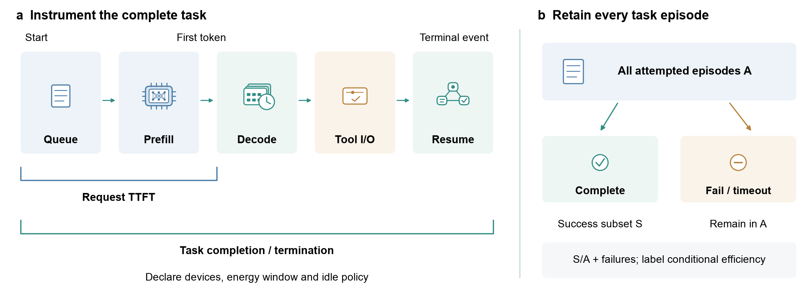

# Evaluation and trust

Measure the capability being claimed at the deployment boundary where it matters. Direct task success, language-model quality proxies and execution measurements answer different questions. Publication venue and code availability are separate from whether a result can be reconstructed.

## Complete-task outcomes

For A attempted episodes and S successes, report S/A with failed and timed-out attempts included. Mean attempt energy is total attempted-task energy divided by A; amortized energy per success uses the same numerator divided by S and is undefined for S=0. A success-only conditional mean answers a different question. Keep request TTFT and p95 separate from task completion time and deadline satisfaction.

- [Empowering Edge Agents: A Systematic Analysis of Edge-Cloud Collaboration in LLM Agent Execution](https://arxiv.org/abs/2610.17816) (arXiv 2026) — EC²-Bench evaluates executable long-horizon tasks, cloud usage and privacy exposure. Estimated local FLOPs are not measured device energy.

The [benchmark protocol](../survey/benchmark_protocol.md) specifies future logs, grouping and energy boundaries. The [helper](../survey/compute_ci.py) summarizes supplied request records and does not reconstruct missing historical traces or infer episode success from call success.

## Device and sustained-session studies

- [MobileAIBench: Benchmarking LLMs and LMMs for On-Device Use Cases](https://arxiv.org/abs/2406.10290) (arXiv 2024) — On-device language/multimodal capability benchmarks.
- [Understanding Large Language Models in Your Pockets: Performance Study on COTS Mobile Devices](https://arxiv.org/abs/2410.03613) (arXiv 2024) — Measurements on commodity mobile devices.
- [LLM Inference at the Edge: Mobile, NPU, and GPU Performance Efficiency Trade-offs Under Sustained Load](https://arxiv.org/abs/2603.23640) (arXiv 2026) — Backend behavior under sustained load.
- [An Evaluation of LLMs Inference on Popular Single-board Computers](https://arxiv.org/abs/2511.07425) (arXiv 2025) — Quantized inference on single-board computers.
- [Characterizing and Understanding Energy Footprint and Efficiency of Small Language Model on Edges](https://arxiv.org/abs/2511.11624) (arXiv 2025) — Platform-specific energy and efficiency measurements.
- [Edge Deployment of Small Language Models, a comprehensive comparison of CPU, GPU and NPU backends](https://arxiv.org/abs/2511.22334) (arXiv 2025) — CPU/GPU/NPU execution under reported configurations.
- [Cloud to Edge: Benchmarking LLM Inference On Hardware-Accelerated Single-Board Computers](https://arxiv.org/abs/2604.24785) (arXiv 2026) — Hardware-accelerated single-board-computer measurements.
- [Phase Matters: Characterizing Heterogeneous Vision-Language Inference on a Mobile SoC](https://arxiv.org/abs/2606.27906) (arXiv 2026) — Phase-specific multimodal execution on a mobile SoC.
- [How Far Are We From On-Device VLM Inference? A Measurement Study on Edge NPUs](https://arxiv.org/abs/2610.40039) (arXiv 2026) — VLM execution and edge-NPU workload differences.
- [How Fast Can I Run My VLA? Demystifying VLA Inference Performance with VLA-Perf](https://arxiv.org/abs/2602.18397) (arXiv 2026) — VLA inference performance across execution stages.
- [VLA-HWBench: Where the Time Goes When VLA Models Run on Edge Hardware](https://arxiv.org/abs/2610.34717) (arXiv 2026) — VLA hardware pipeline breakdowns.

Benchmarks: [MLPerf Inference](https://github.com/mlcommons/inference), [MLPerf Tiny](https://github.com/mlcommons/tiny). Record the suite version, task, data split, precision, runtime, memory, thermal state, power scope and independent repetition unit. A global model leaderboard cannot replace a matched deployment study.

## Security and privacy

Locality can reduce data transfer but does not establish a complete security guarantee. State the adversary and protected objects, including model weights, retained context, sensor input, tool credentials and action state. Distinguish leakage prevention from permission enforcement and recovery.

- [Speed Kills: Exploring Confused Deputy Attacks Through Edge AI Accelerators](https://arxiv.org/abs/2605.17707) (arXiv 2026) — Accelerator interfaces and confused-deputy attack surfaces.
- [Understanding the Security Boundary of Obfuscation-based On-Device LLM Protection](https://arxiv.org/abs/2609.10117) (arXiv 2026) — Security limits of obfuscation-based on-device protection.
- [BiShield-TEE: On the (In-)Security of Unilateral Weight Obfuscation in On-Device TEE-Shielded LLM Partition](https://arxiv.org/abs/2610.21565) (arXiv 2026) — TEE-shielded partition protection and its assumptions.
- [SecureInfer: Heterogeneous TEE-GPU Architecture for Privacy-Critical Tensors for Large Language Model Deployment](https://arxiv.org/abs/2510.19979) (arXiv 2025) — Heterogeneous TEE/GPU deployment boundaries.
- [When FinTech Meets Privacy: Securing Financial LLMs with Differential Private Fine-Tuning](https://arxiv.org/abs/2509.08995) (arXiv 2025) — Differentially private financial-model adaptation.

Check confidentiality, permission scope, revocation, idempotence, network failure and stale state in the full workflow. Report security overhead on the same workload used for capability and cost measurements. See [Foundations and surveys](foundations-and-surveys.md) for complementary threat surveys.

[Back to resource map](../README.md)
