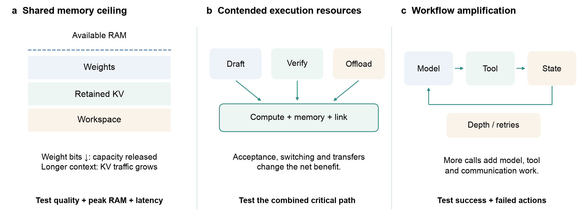

# Optimization under deployment budgets

Start from a feasible, correct baseline and a measured bottleneck. Weight storage, KV state, visual encoding, decoding, tool calls and wireless transfers compete for different resources. A gain in one phase need not improve complete-task latency or energy.

## Context, state and memory

The [analytical memory illustration](../survey/figures/memory_budget.pdf) separates fixed weight storage from context-dependent KV growth. Its [CSV](../survey/figures/memory_budget_analytical.csv) is formula-generated, not a device benchmark; workspace and operating-system cost are excluded.

- [Efficient Memory Management for Large Language Model Serving with PagedAttention](https://arxiv.org/abs/2309.06180) (arXiv 2023) — Paged KV management for serving; mobile transfer requires a supported implementation.
- [DUAL-BLADE: Dual-Path NVMe-Direct KV-Cache Offloading for Edge LLM Inference](https://arxiv.org/abs/2604.26557) (arXiv 2026) — Storage-backed KV transfer and edge execution.
- [MemLLM: End-to-end In-Storage Acceleration of On-device Retrieval-Augmented Generation using Precomputed KV Caches](https://arxiv.org/abs/2610.22579) (arXiv 2026) — Precomputed RAG state and storage/compute interaction.
- [Lightweight Chunk Selection for Mobile Retrieval-Augmented Generation](https://arxiv.org/abs/2608.03148) (arXiv 2026) — Selection of retrieved context before mobile generation.

## Precision and model structure

- [AWQ: Activation-aware Weight Quantization for LLM Compression and Acceleration](https://arxiv.org/abs/2306.00978) (arXiv 2023) — Activation-aware weight quantization and its executable kernel path.
- [GPTQ: Accurate Post-Training Quantization for Generative Pre-trained Transformers](https://arxiv.org/abs/2210.17323) (arXiv 2022) — Post-training weight quantization.
- [SmoothQuant: Accurate and Efficient Post-Training Quantization for Large Language Models](https://arxiv.org/abs/2211.10438) (arXiv 2022) — Joint treatment of activation/weight dynamic ranges.
- [The Era of 1-bit LLMs: All Large Language Models are in 1.58 Bits](https://arxiv.org/abs/2402.17764) (arXiv 2024) — Low-bit model representation; storage and runtime remain distinct.
- [Large Models for Small Devices: Recent Advances and Empirical Analysis of Edge AI Deployment](https://arxiv.org/abs/2608.15693) (arXiv 2026) — Checks whether compression changes survive artifact export and actual execution.
- [Does Mixture-of-Experts Actually Help Inference on Consumer and Edge Hardware? An Empirical Study](https://arxiv.org/abs/2606.21428) (arXiv 2026) — Separates active expert arithmetic from total storage and memory traffic.

- [MobileQuant: Mobile-friendly Quantization for On-device Language Models](https://doi.org/10.18653/v1/2024.findings-emnlp.570) (EMNLP Findings 2024) — quantization and operator conditions for mobile inference.
- [Token-Importance Guided Direct Preference Optimization](https://proceedings.iclr.cc/paper_files/paper/2026/hash/172fe9f8cc55953bad5c24774bf0142b-Abstract-Conference.html) (ICLR 2026) — behavioral alignment; its quality objective is separate from a hardware precision reduction.

## Decoding and test-time work

- [Accelerating Large Language Model Decoding with Speculative Sampling](https://arxiv.org/abs/2302.01318) (arXiv 2023) — Draft/verify decoding and its sampling assumptions.
- [QSpec: Speculative Decoding with Complementary Quantization Schemes](https://arxiv.org/abs/2410.11305) (arXiv 2024) — Complementary precision paths for speculation.
- [FastTTS: Accelerating Test-Time Scaling for Edge LLM Reasoning](https://arxiv.org/abs/2509.00195) (arXiv 2025) — Verifier-guided reasoning search (ASPLOS 2026); beam goodput differs from completed user goals.
- [SpecQuant: Speculative Decoding with Multi-Parent Quantization for Adaptive LLM Inference](https://arxiv.org/abs/2609.21704) (arXiv 2026) — Adaptive precision variants and speculative inference.

- [EAGLE-2: Faster Inference of Language Models with Dynamic Draft Trees](https://doi.org/10.18653/v1/2024.emnlp-main.422) (EMNLP 2024).

Measure drafting, verification, switching, accepted output and rejected work together. Acceptance rate alone cannot establish speedup, and a reasoning-token cap alone cannot establish preserved task quality.

## Runtime, scheduling and hardware mapping

- [PowerInfer: Fast Large Language Model Serving with a Consumer-grade GPU](https://arxiv.org/abs/2312.12456) (arXiv 2023) — Consumer-GPU sparse-activation serving.
- [PowerInfer-2: Fast Large Language Model Inference on a Smartphone](https://arxiv.org/abs/2406.06282) (arXiv 2024) — Smartphone inference and heterogeneous memory/execution design.
- [SLICE: SLO-Driven Scheduling for LLM Inference on Edge Computing Devices](https://arxiv.org/abs/2510.18544) (arXiv 2025) — SLO-driven edge scheduling.
- [EPARA: Parallelizing Categorized AI Inference in Edge Clouds](https://arxiv.org/abs/2511.00603) (arXiv 2025) — Parallel execution in edge clouds.
- [FourierCompress: Layer-Aware Spectral Activation Compression for Efficient and Accurate Collaborative LLM Inference](https://arxiv.org/abs/2510.16418) (arXiv 2025) — Activation transfer in collaborative inference.
- [EdgeXpert: An Edge Device for Memory-Efficient LLM Inference with Mixture-of-Experts and Speculative Decoding](https://arxiv.org/abs/2608.05303) (arXiv 2026) — MoE/speculation hardware–software co-design; retain the reported accelerator boundary.
- [EnerInfer: Energy-Aware On-Device LLM Inference](https://arxiv.org/abs/2606.23001) (arXiv 2026) — Energy-aware device execution with frequency and thermal constraints.

- [Fast On-Device LLM Inference with NPUs](https://doi.org/10.1145/3669940.3707239) (ASPLOS 2025).
- [T-MAC: CPU Renaissance via Table Lookup for Low-bit LLM Deployment on Edge](https://doi.org/10.1145/3689031.3696099) (EuroSys 2025).
- [SwapMoE: Serving Off-the-shelf MoE-based Large Language Models with Tunable Memory Budget](https://doi.org/10.18653/v1/2024.acl-long.363) (ACL 2024).

## Adaptation and federated learning

- [LoRA: Low-Rank Adaptation of Large Language Models](https://arxiv.org/abs/2106.09685) (arXiv 2021) — Low-rank adaptation with a retained base model.
- [DoRA: Weight-Decomposed Low-Rank Adaptation](https://arxiv.org/abs/2402.09353) (arXiv 2024) — Weight-decomposed adaptation.
- [Memory-Efficient Structured Backpropagation for On-Device LLM Fine-Tuning](https://arxiv.org/abs/2602.13069) (arXiv 2026) — Structured backpropagation for memory-constrained fine-tuning.
- [TrainDeeploy: Hardware-Accelerated Parameter-Efficient Fine-Tuning of Small Transformer Models at the Extreme Edge](https://arxiv.org/abs/2603.09511) (arXiv 2026) — Hardware-aware adaptation of small transformers at the extreme edge.
- [Training Specialist LLMs on Your Phone: Forward-Only Optimization via Block-Spectral Coordinates](https://arxiv.org/abs/2611.04797) (arXiv 2026) — Forward-only phone specialization; retain its demonstrated training conditions.
- [Unlocking the Edge deployment and ondevice acceleration of multi-LoRA enabled one-for-all foundational LLM](https://arxiv.org/abs/2604.18655) (arXiv 2026) — Multi-adapter execution and mobile acceleration.
- [Federated Learning of Large Language Models with Parameter-Efficient Prompt Tuning and Adaptive Optimization](https://arxiv.org/abs/2310.15080) (arXiv 2023) — Parameter-efficient federated adaptation and optimization.
- [Parameter-Efficient and Personalized Federated Training of Generative Models at the Edge](https://arxiv.org/abs/2511.11585) (arXiv 2025) — Personalized generative adaptation across edge clients.
- [FED-FSTQ: Fisher-Guided Token Quantization for Communication-Efficient Federated Fine-Tuning of LLMs on Edge Devices](https://arxiv.org/abs/2604.25421) (arXiv 2026) — Communication-aware federated token quantization.
- [Thermo-FL: Thermal-Aware Robust Federated Fine-Tuning of Large Language Models for Edge AI](https://arxiv.org/abs/2608.21172) (arXiv 2026) — Thermal-aware federated fine-tuning.

- [QLoRA: Efficient Finetuning of Quantized LLMs](https://proceedings.neurips.cc/paper_files/paper/2023/hash/1feb87871436031bdc0f2beaa62a049b-Abstract.html) (NeurIPS 2023).
- [Federated Black-box Prompt Tuning System for Large Language Models on the Edge](https://doi.org/10.1145/3636534.3698856) (MobiCom 2024).

Tooling: [AWQ](https://github.com/mit-han-lab/llm-awq), [GPTQ](https://github.com/IST-DASLab/gptq), [SmoothQuant](https://github.com/mit-han-lab/smoothquant), [OmniQuant](https://github.com/OpenGVLab/OmniQuant), [PEFT](https://github.com/huggingface/peft), [bitsandbytes](https://github.com/bitsandbytes-foundation/bitsandbytes).

Report whether adapters are merged, switched or served concurrently. Base weights, activation memory, communication, update cost and quality drift remain relevant after trainable parameters are reduced.

[Back to resource map](../README.md)
